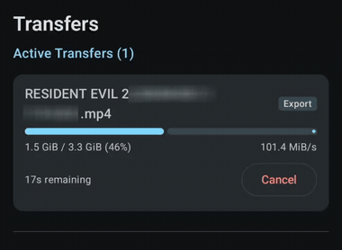
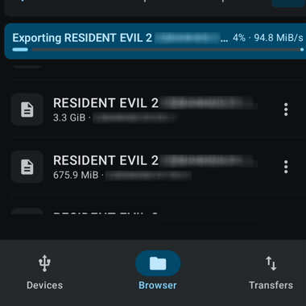

<div align="center">

<!-- Demonstration banner / social preview placeholder -->


<h1>LUKS-Android</h1>

<p><strong>A rootless, userspace storage and cryptographic stack for Android.</strong><br/>
Unlock, read, and write LUKS/LUKS2 encrypted external drives formatted with Btrfs or ext4 over USB-OTG.<br/>
Zero root, zero kernel modules, 100% offline and air-gapped, fail-closed safety.</p>

<a href="https://github.com/rDelmotra/Nyx/releases/latest"></a>


<a href="LICENSE-APACHE"></a>

<br/><br/>

<strong><a href="#quickstart">Download</a> &nbsp;&middot;&nbsp; <a href="#what-is-luks-android">What is it?</a> &nbsp;&middot;&nbsp; <a href="#comparison">Comparison</a> &nbsp;&middot;&nbsp; <a href="#features">Features</a> &nbsp;&middot;&nbsp; <a href="#how-to-use">How to use</a> &nbsp;&middot;&nbsp; <a href="#frequently-asked-questions-faq">FAQ</a> &nbsp;&middot;&nbsp; <a href="#build-from-source">Build</a> &nbsp;&middot;&nbsp; <a href="doc/architecture.md">Architecture</a> &nbsp;&middot;&nbsp; <a href="doc/testing.md">Testing</a></strong>

</div>

<br/>

> [!IMPORTANT]
> **Can you access LUKS-encrypted, Btrfs, or ext4 drives on Android without root?**  
> **Yes.** Stock Android does not provide native kernel drivers for Btrfs, ext4, or LUKS2 external drives—plugging a Linux drive into an unmodified Android phone usually triggers an *"Issue with USB drive / Tap to format"* warning. **LUKS-Android** solves this by implementing the entire cryptographic transform, SCSI translation, and filesystem engines in userspace via Android's USB Host API (`/dev/bus/usb`). Zero root privileges, zero kernel modifications, and zero cloud dependencies.

---

## What is LUKS-Android?

**LUKS-Android is an open-source userspace driver and filesystem explorer that lets Android devices unlock, read, and write LUKS-encrypted drives formatted with Btrfs or ext4.** Plug any standard encrypted USB-OTG drive, NVMe SSD, or external storage device into an Android phone or tablet, grant USB access, enter your passphrase (or tap fingerprint), and browse the filesystem directly.

Traditional solutions require rooting the Android device, installing custom kernels, or cross-compiling kernel modules (`dm-crypt`, `btrfs.ko`)—which voids warranties and trips device integrity checks. LUKS-Android moves the entire stack into an unprivileged userspace process:
- A high-performance **Rust core** handles cryptographic decryption (AES-256-XTS, Argon2id, PBKDF2), SCSI translation, and B-tree/extent traversals.
- A modern **Jetpack Compose UI** provides directory browsing, in-app media playback, background file transfers, and real-time hardware diagnostics.

<p align="center">
  
  &nbsp;
  
</p>
<p align="center">
  <em>Live 95–100+ MiB/s export in action: real-time in-browser progress (left) and dedicated background transfer queue (right).</em>
</p>

---

## Comparison

How LUKS-Android compares to standard Android external storage handling and traditional rooting:

| Capability | Stock Android | Root / Custom Kernel (`dm-crypt`, `btrfs.ko`) | **LUKS-Android** |
| :--- | :---: | :---: | :---: |
| **Root Required?** | None | **Yes (Magisk/KernelSU required)** | **None (100% Unprivileged)** |
| **Device Integrity** | Intact | ❌ Tripped (Banking apps & DRM break) | **✅ 100% Intact** |
| **LUKS / LUKS2 Decryption** | ❌ Unsupported | ⚠️ CLI only (`cryptsetup` via Termux) | **✅ In-App GUI + Biometric Unlock** |
| **Btrfs Filesystem Support** | ❌ "Drive Corrupt / Tap to Format" | ⚠️ Requires custom kernel compilation | **✅ Full Read & Write (Subvolumes `@` & `@home`)** |
| **ext4 External Storage** | ❌ Ignored on OTG | ✅ Supported via kernel mount | **✅ Full Read & Write** |
| **Plain (Unencrypted) Drives** | ⚠️ FAT32 / exFAT only | ✅ Supported | **✅ Btrfs & ext4 supported** |
| **Network & Privacy Profile** | Varies | Varies | **✅ 100% Offline (No `INTERNET` permission)** |
| **Direct Media Playback** | ❌ Cannot open encrypted drives | ⚠️ Requires manual extraction | **✅ In-memory zero-wear caching** |

---

## Quickstart

**[⬇ Download the latest release](https://github.com/rDelmotra/Nyx/releases/latest)** — grab `app-release.apk` (v0.4.0) directly, no build required. Requires Android 10+ (API 29) on an `arm64-v8a` device.

> [!NOTE]
> The `v0.4.0` release introduces **hardware-backed biometric unlock** (fingerprint / face authentication via Android Keystore backed AES-GCM passphrase vault), alongside **in-app media playback** with zero-wear in-memory block caching, air-gapped zero-network security, and full ext4/Btrfs write support.

> [!WARNING]
> **Write at your own risk.** Writing directly to raw block storage from unprivileged userspace over mobile USB-OTG carries inherent physical risk. While this engine is verified against Linux kernel oracles and enforces fail-closed write fencing, real-world hardware disruptions (unstable OTG adapters, loose USB-C cables, surprise disconnections, or drive controllers rejecting cache flush) can interrupt in-flight transactions. **Always maintain verified backups of critical data before performing write operations.**

| Target | Artifact | Size | Description |
| :--- | :--- | :--- | :--- |
| **Android Release (Recommended)** | [`app-release.apk`](https://github.com/rDelmotra/Nyx/releases/latest) | `~6.2 MB` | Prebuilt, signed v2/v3, ready to install |
| **Android Debug** *(build from source)* | `app-debug.apk` | `~32 MB` | For development and live diagnostics |
| **Native Core (Rust crate)** | `luks_core` / `luks_jni` | `< 2 MB` | Standalone Rust engine or JNI bridge |

#### Release Asset Verification (v0.4.0)

```
46b7e49304a7a5c290af830b99f66b745e19f20fb7b74ca3b5bfe9fc6079cae7  app-release.apk
```

### Install via ADB

```bash
# Download app-release.apk from the Releases page above, then:
adb install -r app-release.apk

# Or, after building the release APK from source yourself (see below):
adb install -r android/app/build/outputs/apk/release/app-release.apk
```

> [!TIP]
> **No ADB?** Open the [release APK link](https://github.com/rDelmotra/Nyx/releases/latest) directly on your Android phone and tap the downloaded file to install. Android will prompt to allow "Install unknown apps" for the browser or file manager used.

---

## How to use

1. **Connect the drive.** Plug a USB-C external SSD, thumb drive, or USB-OTG enclosure into your Android device.
2. **Grant USB permission.** Accept the standard Android USB Host prompt to allow direct userspace communication via `/dev/bus/usb`.
3. **Unlock the volume.** Enter your LUKS passphrase or tap the biometric fingerprint prompt to decrypt the keyslot.
4. **Browse, stream, or transfer.** Explore directory trees, view file metadata, stream videos and music in-app, or export files directly to Android internal storage.

---

## Features

- **Rootless & Zero-Root Operation.** Runs entirely in unprivileged userspace using Android's USB Host APIs (`/dev/bus/usb`). No root access, unlocked bootloaders, Magisk, or custom ROMs required.
- **Hardware-Backed Biometric Unlock.** Unlock encrypted LUKS2 containers using fingerprint or face authentication (`BiometricPrompt`). Passphrases are vaulted inside the hardware-isolated `AndroidKeyStore` using AES-256-GCM with biometric authentication-per-use gating and auto-invalidation if enrollment changes.
- **In-App Media Player.** High-performance video and audio playback directly from decrypted LUKS2 containers and plain drives powered by AndroidX Media3 (ExoPlayer). Features a 1 MiB (4 × 256 KiB) in-memory LRU block cache that eliminates SSD flash wear with zero disk extraction and zero network permissions.
- **Air-Gapped & 100% Offline Security.** The application requests zero network permissions (`android.permission.INTERNET` is completely omitted from `AndroidManifest.xml`). No telemetry, no cloud calls, no open local ports.
- **LUKS2 Container Cryptography.** Full support for Argon2id and PBKDF2 key derivation functions with AES-256-XTS ciphers, hardware-accelerated via ARMv8 crypto extensions (`pmull`, `aes`).
- **Memory Security and Key Zeroization.** Master keys, subkeys, and expanded cipher schedules implement `Zeroize` and `ZeroizeOnDrop`, purging sensitive material from memory immediately upon exit.
- **Btrfs Filesystem Engine.** Complete B-tree Copy-on-Write (CoW) mutation engine, live Castagnoli CRC32c checksum calculations, dynamic multi-gigabyte chunk allocation, and Free-Space Tree (FST) CoW management.
- **Btrfs Subvolume Write Support.** First-class write transactions directly targeting subvolumes (`@`, `@home`, snapshots) via single-tree encapsulation, extent backrefs, and packed checksum trimming.
- **Plain (Non-LUKS) Volume Support.** Open, browse, and write to unencrypted ext4 and Btrfs drives with hardened 7-point superblock detection and explicit per-session write confirmation.
- **Transparent Decompression.** Reads compressed Btrfs extents on-the-fly supporting Zstandard (zstd), LZO, and Zlib algorithms.
- **ext4 Filesystem Engine.** Extent tree traversals, directory hash-tree indexing, block group bitmap allocations, and file creation/deletion validated against reference Linux `e2fsck`.
- **SCSI Bulk-Only Transport (BOT).** Custom userspace USBFS engine driving 128 KiB chunked SCSI transfers with a non-blocking URB arena and generational drain recovery.
- **Fail-Closed Safety Model.** Release builds enforce compile-time write gating (`dangerous-write-support`). Any transport stall, cable disconnect, or corruption fences the session instantly.
- **Lightweight Footprint.** Complete Android application is ~6.2 MB, with ProGuard/R8 code and resource shrinking.
- **In-Memory Forensic Ring Buffer.** A 256-slot non-allocating circular ring buffer records hardware events, SCSI CDBs, sense codes, and filesystem operations with zero plaintext leakage.

Full system architecture, hardware benchmarks, and the per-feature read/write support matrix are in [doc/architecture.md](doc/architecture.md).

---

## Frequently Asked Questions (FAQ)

### Can I open a LUKS2 encrypted drive on Android without rooting?
**Yes.** LUKS-Android executes entirely in userspace using Android's native USB Host APIs. It does not require root privileges, Magisk, KernelSU, or an unlocked bootloader.

### Does Android natively support Btrfs or ext4 USB drives?
**No.** Stock Android does not include kernel drivers or mount utilities for Btrfs, ext4, or LUKS external storage. Connecting an ext4 or Btrfs drive to standard Android triggers an *"Issue with USB drive / Tap to format"* warning. LUKS-Android bypasses this limitation by reading and writing filesystems in userspace without mounting them into the Android OS VFS.

### Can I write to Btrfs subvolumes (@ and @home)?
**Yes.** LUKS-Android v0.4.0 supports full read and write transactions directly targeting subvolumes (such as `@` root and `@home` subvolumes generated by Fedora, Ubuntu, and Arch Linux) via single-tree encapsulation and extent backrefs.

### Can I play video or audio stored inside a LUKS container directly?
**Yes.** LUKS-Android integrates native media playback using AndroidX Media3 (ExoPlayer) with a 1 MiB in-memory read-ahead LRU block cache. Media streams directly from RAM without extracting full files to internal device flash storage.

### Is my passphrase or data transmitted over any network?
**No.** LUKS-Android is 100% air-gapped. The `android.permission.INTERNET` permission is omitted from the manifest, and no network sockets or local loopback servers are created.

### How fast are transfers over USB-OTG?
On physical hardware with modern USB-C NVMe storage (Rig B), LUKS-Android achieves raw reads of **~108.7 MiB/s**, application file exports of **~96.5 MiB/s**, and file imports of **75.0–90.0 MiB/s**. On commodity USB 3.2 thumb drives (Rig A), sustained file exports run at **~21.2 MiB/s**. See [doc/architecture.md](doc/architecture.md) for full benchmarks.

---

## Build from source

### Prerequisites

1. **Rust Toolchain (1.80+)**: `rustup target add aarch64-linux-android`
2. **Android NDK**: NDK r25c or newer (set `ANDROID_NDK_HOME`).
3. **Android SDK**: Build tools 34.0.0+, JDK 17+.
4. **Colima / Docker** *(Optional)*: Required to run Linux kernel-graded oracle validation tests.

### 1. Compile the Native Android Library (`libluks_jni.so`)

The cryptographic and filesystem engine compiles to an `arm64-v8a` shared library:

```bash
# Safe, Read-Only Default Build
./tools/build-android-libs.sh

# Write-Enabled Testing Build (opt-level 3, LTO, stripped)
./tools/build-android-libs.sh --write
```

### 2. Build the Android Application

```bash
cd android

# Production Release Build (R8-optimized, requires -PallowWriteInRelease=true if native write is enabled)
./gradlew assembleRelease -PallowWriteInRelease=true
# Output: app/build/outputs/apk/release/app-release.apk

# Debug Build (Fast local compilation with debug tracing)
./gradlew assembleDebug
# Output: app/build/outputs/apk/debug/app-debug.apk
```

Full test suite, kernel-oracle grading, and live diagnostic log extraction are in [doc/testing.md](doc/testing.md).

---

## Security & Safety

- **No Plaintext Logging:** Passphrases, derived keys, and directory contents are never written to disk, Android logcat, or diagnostic buffers.
- **Immediate Memory Purging:** Cryptographic secrets implement `ZeroizeOnDrop`, clearing backing memory buffers as soon as an operation finishes.
- **Fail-Closed Default:** If a USB transfer stalls, a device disconnects unexpectedly, or an inconsistent filesystem state is detected, the driver halts immediately to prevent data loss.

---

## Contributing

- Read [CONTRIBUTING.md](CONTRIBUTING.md) before opening a PR — testing and hardware-in-the-loop expectations are there.
- Bug reports: include hardware details, kernel version, and ADB diagnostic logs.
- Security issues go through [SECURITY.md](SECURITY.md), not a public issue.

---

## License

Created and maintained by **Rehaan Delmotra**.

Licensed under either of [Apache License, Version 2.0](LICENSE-APACHE) or [MIT license](LICENSE-MIT) at your option.

Unless you explicitly state otherwise, any contribution intentionally submitted for inclusion in this project by you, as defined in the Apache-2.0 license, shall be dual licensed as above, without any additional terms or conditions.
